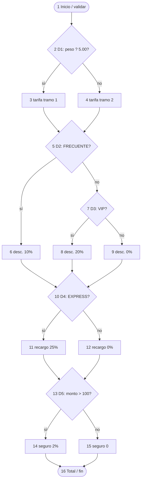
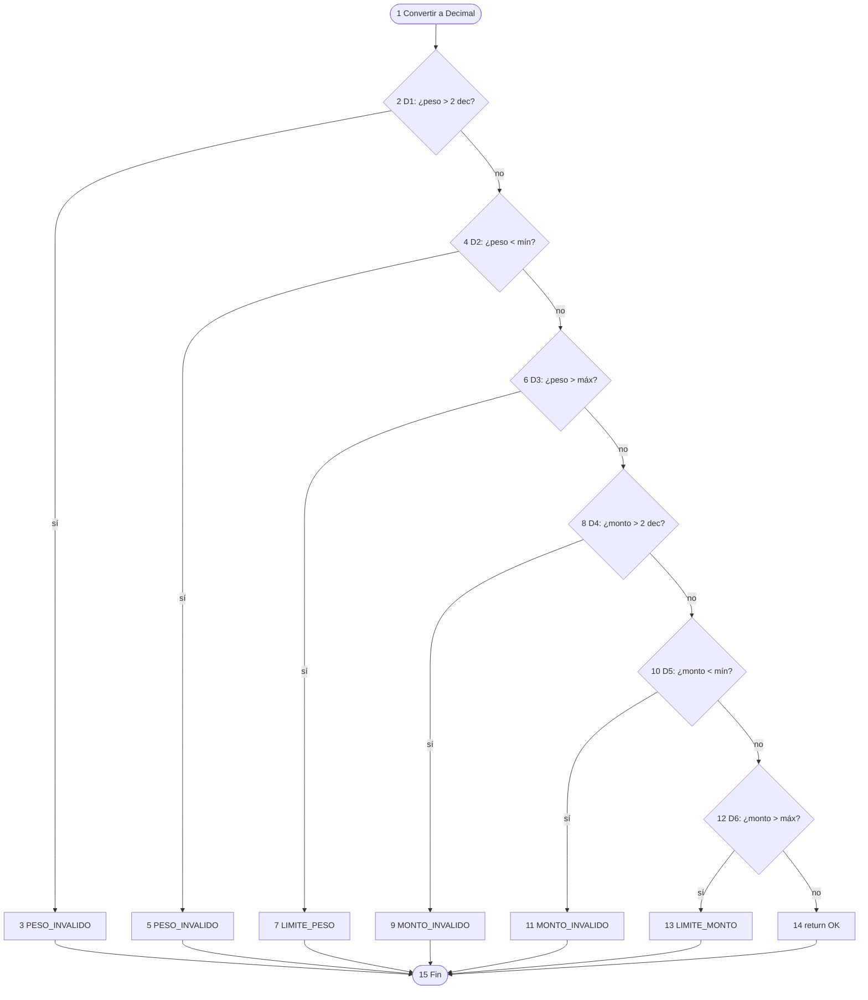

# 6. Plan de pruebas de caja blanca

**Requisito del enunciado:** diagrama CFG del algoritmo principal, cálculo de V(G) y
cobertura de caminos independientes.

El algoritmo se dividió en dos funciones con V(G) = 6 y 7; sus **13 caminos independientes**
tienen cada uno una prueba automatizada y las 13 se aprobaron (ciclo 1).
Se separó validación y cálculo para que cada grafo sea legible y ninguna función supere
el umbral de McCabe (V(G) ≤ 10). En el código, las decisiones llevan comentarios `# D1`, `# D2`…

**Archivo de pruebas:** `tests/unit/test_caja_blanca.py`

## 6.1 Función principal: `calcular_tarifa`

Pseudocódigo (nodos alineados al grafo):

```text
1  peso, monto = validar_cotizacion(...)
2  if peso <= LIMITE_TRAMO_1:          # D1
3      tarifa_kg = TARIFA_KG_TRAMO_1
4  else: tarifa_kg = TARIFA_KG_TRAMO_2
5  cargo_peso / subtotal; if FRECUENTE: # D2
6      descuento FRECUENTE
7  elif VIP:                            # D3
8      descuento VIP
9  else: descuento NUEVO
10 if EXPRESS:                          # D4
11     recargo EXPRESS
12 else: recargo ESTANDAR
13 if monto > UMBRAL_SEGURO:            # D5
14     seguro = 2 %
15 else: seguro = 0
16 total = ...; return Cotizacion
```

### Grafo de flujo de control (CFG) — `calcular_tarifa`



### Cálculo de la complejidad ciclomática — `calcular_tarifa`

Los tres métodos dan el mismo resultado. `radon cc` confirma: `calcular_tarifa - B (6)`.

| Método | Fórmula | Datos | Resultado |
|---|---|---|---|
| Aristas y nodos | V(G) = E − N + 2 | E = 20, N = 16 | **6** |
| Nodos predicado | V(G) = P + 1 | P = 5 (nodos 2, 5, 7, 10, 13) | **6** |
| Regiones | V(G) = regiones | 5 cerradas + 1 exterior | **6** |

### Caminos independientes — `calcular_tarifa`

V(G) = 6 → se necesitan **6 caminos**. C1 es el camino base; cada camino siguiente cambia una decisión.

| Camino | Secuencia de nodos | Decisión que cambia | Entrada (peso, cliente, envío, monto) | Total | Prueba | Estado |
|---|---|---|---|---|---|---|
| C1 | 1-2-3-5-7-9-10-12-13-15-16 | Base | 3, NUEVO, ESTANDAR, 50 | $11.00 | C1-base | Aprobado |
| C2 | 1-2-4-5-7-9-10-12-13-15-16 | D1 falso (tramo 2) | 12, NUEVO, ESTANDAR, 50 | $53.00 | C2-D1-falso | Aprobado |
| C3 | 1-2-3-5-6-10-12-13-15-16 | D2 verdadero (FRECUENTE) | 3, FRECUENTE, ESTANDAR, 50 | $9.90 | C3-D2-verdadero | Aprobado |
| C4 | 1-2-3-5-7-8-10-12-13-15-16 | D3 verdadero (VIP) | 3, VIP, ESTANDAR, 50 | $8.80 | C4-D3-verdadero | Aprobado |
| C5 | 1-2-3-5-7-9-10-11-13-15-16 | D4 verdadero (EXPRESS) | 3, NUEVO, EXPRESS, 50 | $13.75 | C5-D4-verdadero | Aprobado |
| C6 | 1-2-3-5-7-9-10-12-13-14-16 | D5 verdadero (seguro) | 3, NUEVO, ESTANDAR, 500 | $21.00 | C6-D5-verdadero | Aprobado |

## 6.2 Función de validación: `validar_cotizacion`

```text
1  peso = _a_decimal(...); monto = _a_decimal(...)
2  if más de 2 decimales en peso:     # D1 ? 3 error
4  if peso < mínimo:                  # D2 ? 5 error
6  if peso > máximo:                  # D3 ? 7 rechazo
8  if más de 2 decimales en monto:    # D4 ? 9 error
10 if monto < mínimo:                 # D5 → 11 error
12 if monto > máximo:                 # D6 ? 13 rechazo
14 return peso, monto cuantizados
15 fin (todas las salidas llegan aquí)
```

### Grafo de flujo de control (CFG) — `validar_cotizacion`



### Cálculo de V(G) — `validar_cotizacion`

`radon`: `validar_cotizacion - B (7)`.

| Método | Fórmula | Datos | Resultado |
|---|---|---|---|
| Aristas y nodos | V(G) = E − N + 2 | E = 20, N = 15 | **7** |
| Nodos predicado | V(G) = P + 1 | P = 6 | **7** |
| Regiones | V(G) = regiones | 6 cerradas + 1 exterior | **7** |

### Caminos independientes — `validar_cotizacion`

| Camino | Secuencia | Entrada (peso, monto) | Resultado esperado | Prueba | Estado |
|---|---|---|---|---|---|
| V1 | 1-2-4-6-8-10-12-14-15 | 3, 50 | Retorna (3.00, 50.00) | test_V1_camino_valido | Aprobado |
| V2 | 1-2-3-15 | 3.001, 50 | `PESO_INVALIDO` | V2-D1-peso-decimales | Aprobado |
| V3 | 1-2-4-5-15 | 0, 50 | `PESO_INVALIDO` | V3-D2-peso-bajo-minimo | Aprobado |
| V4 | 1-2-4-6-7-15 | 20.01, 50 | `LIMITE_PESO_EXCEDIDO` | V4-D3-peso-sobre-maximo | Aprobado |
| V5 | 1-2-4-6-8-9-15 | 3, 50.001 | `MONTO_INVALIDO` | V5-D4-monto-decimales | Aprobado |
| V6 | 1-2-4-6-8-10-11-15 | 3, 0 | `MONTO_INVALIDO` | V6-D5-monto-bajo-minimo | Aprobado |
| V7 | 1-2-4-6-8-10-12-13-15 | 3, 1000.01 | `LIMITE_MONTO_EXCEDIDO` | V7-D6-monto-sobre-maximo | Aprobado |

## 6.3 Complejidad del resto del código

| Función | V(G) | Riesgo (McCabe) |
|---|---|---|
| `validar_cotizacion` | 7 | Bajo (1–10) |
| `calcular_tarifa` | 6 | Bajo |
| `_a_decimal` | 4 | Bajo |
| `manejar_error_entrada` (API) | 4 | Bajo |
| Resto | 1–2 | Bajo |

Promedio del backend en ciclo 1: **1.82**. Ninguna función supera 7.
Tras DEF-004 (ciclo 2), `_tiene_mas_de_dos_decimales` pasó de V(G) 1 a 2; el máximo sigue en **7**.
