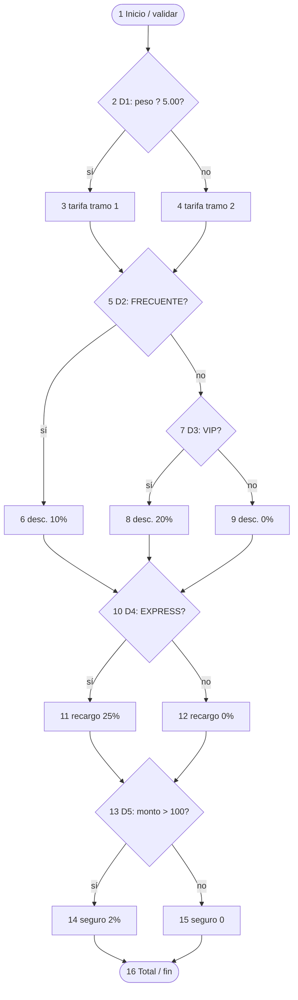
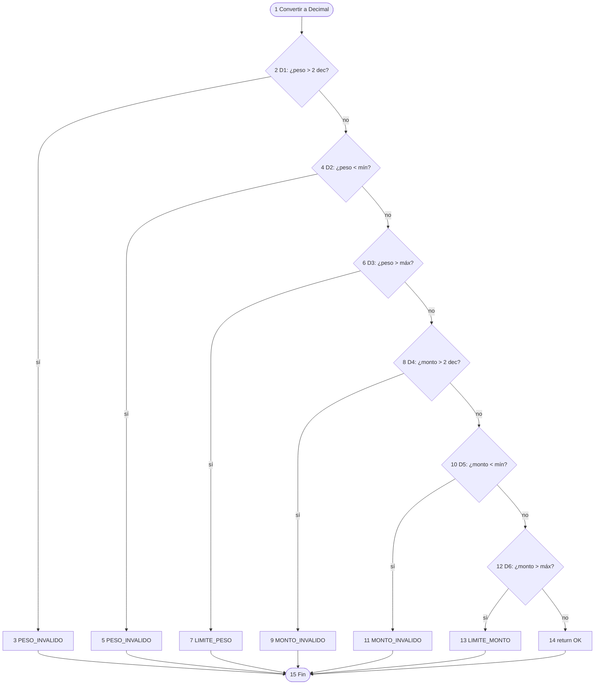

# Informe técnico de Calidad de Software — FastExpress

> Documento unificado para entrega.

---

# 1. Datos del proyecto

| Campo | Detalle |
|---|---|
| Asignatura | Calidad de Software |
| Institución | Corporación Universitaria Politécnico de la Costa Atlántica |
| Proyecto | Proyecto Integrador: Sistema de Calidad y Pruebas de Software |
| Sistema | Módulo de Cotización de Envíos y Descuentos "FastExpress" |
| Entrega | 27 de octubre de 2026, 8:15 p.m. |
| Modalidad | Equipo de 3 integrantes |

## Roles

| Rol | Integrante | Responsabilidad principal | Adicionales |
|---|---|---|---|
| Desarrollador Backend | Julián Robles | Reglas de negocio, algoritmo y API REST | Repositorio API, CI, métricas de fiabilidad/eficiencia/mantenibilidad |
| Desarrollador Frontend | Kenneth Rojas | Interfaz, conexión con la API, validaciones de UI | Usabilidad, rediseño y alertas |
| Analista de Calidad (QA) | Luis Daniel Cantillo Ospino | Caja negra, caja blanca, automatización y cobertura | Gestión de defectos, trazabilidad, consolidación de métricas e informe |

Todos los integrantes participan en la redacción y revisión de este informe.


---

# 2. Introducción y alcance

FastExpress cotiza el valor de un envío a partir del peso, el valor declarado, el tipo de
cliente y el tipo de envío. El sistema se validó con una suite automatizada de caja negra,
caja blanca, API y E2E, midiendo cobertura de líneas y ramas por encima del 85 % exigido.

**Objetivo.** Construir el módulo de cotización y demostrar su calidad con pruebas de caja
negra, caja blanca, cobertura y evaluación del producto.

## Alcance

- Algoritmo de cálculo con las reglas BR-01 a BR-04 del enunciado y BR-05 propuesta por el equipo.
- API REST que expone la cotización y responde errores con códigos de negocio.
- Interfaz web (Next.js) con formulario y desglose del valor.
- Suite de pruebas automatizadas (PyTest) con reporte de cobertura.
- Integración continua en el repositorio de la API y proceso con issues, ramas y pull requests.

**Fuera de alcance.** Persistencia de cotizaciones, autenticación, pagos y rastreo de envíos.


---

# 3. Especificación y supuestos

## 3.1 Reglas de negocio

| Regla | Descripción | Origen |
|---|---|---|
| BR-01 | Tarifa base $5.00 USD por orden | Enunciado |
| BR-02 | 0.01–5.00 kg: $2.00/kg; 5.01–20.00 kg: $4.00/kg; > 20.00 kg: rechazo | Enunciado |
| BR-03 | NUEVO 0 %; FRECUENTE 10 %; VIP 20 % | Enunciado |
| BR-04 | ESTANDAR 0 %; EXPRESS +25 % sobre el subtotal con descuento | Enunciado |
| BR-05 | Monto declarado 0.01–100.00: sin seguro; 100.01–1,000.00: seguro 2 %; > 1,000.00: rechazo | Propuesta del equipo |

Sobre *Monto*, el docente indicó que no estaba estipulado y que el equipo podía proponerlo.
Se definió como el **valor declarado** del contenido.

## 3.2 Fórmula de cálculo

```
Total = (5 + P · T_kg) · (1 − d) · (1 + r) + S
```

Donde `P` = peso, `T_kg` = tarifa por kg, `d` = descuento, `r` = recargo, `S` = seguro.

En la implementación se calcula por componentes con `Decimal` y redondeo `ROUND_HALF_UP`
al centavo, de modo que el desglose suma exactamente el total:

1. `cargo_peso = redondear(P × T_kg)`
2. `subtotal = 5 + cargo_peso`
3. `descuento = redondear(subtotal × d)`
4. `recargo = redondear((subtotal − descuento) × r)`
5. `seguro = redondear(monto × 0.02)` si aplica
6. `total = subtotal − descuento + recargo + seguro`

## 3.3 Ambigüedades y decisiones

| Ambigüedad | Decisión del equipo | Efecto si se hubiera elegido otra |
|---|---|---|
| Campo Monto no definido | Valor declarado + BR-05 | Sin regla propia de entrada |
| Orden descuento/recargo | Recargo sobre subtotal ya descontado | 10 kg VIP EXPRESS: $45.00 vs $47.25 |
| Cobro del peso | Todo el peso a la tarifa de su rango | Escalonado cambiaría totales |
| Rangos con 2 decimales | 5.005 kg no pertenece a ningún tramo → rechazo | — |


---

# 4. Arquitectura, herramientas y estrategia de pruebas

La lógica de negocio vive en un módulo independiente de la API y de la interfaz
(`fastexpress-api/app/core/`), lo que permite probarla sin levantar el servidor.

## 4.1 Componentes

| Componente | Tecnología | Ubicación |
|---|---|---|
| Core de negocio | Python 3.12+, `decimal.Decimal` | `app/core/` (`reglas.py`, `errores.py`, `cotizador.py`) |
| API REST | FastAPI | `app/main.py`, `app/schemas.py` |
| Interfaz | Next.js 15 + React 19 | repo `fastexpress-frontend` |
| Pruebas | PyTest, pytest-cov, TestClient, Playwright | `tests/unit/`, `tests/api/`, `tests/e2e/` |
| CI | GitHub Actions (`pruebas`) | `.github/workflows/pruebas.yml` |

## 4.2 Estrategia de pruebas

| Nivel | Técnica | Objeto | Casos (ciclo 1) |
|---|---|---|---|
| Unidad / integración lógica | Caja negra (EP, BVA, decisión) | Peso, monto, cliente×envío | 38 |
| Unidad | Caja blanca (caminos) | `calcular_tarifa`, `validar_cotizacion` | 13 |
| Unidad | Robustez | Entradas atípicas y propiedad del desglose | 223 |
| API | Contrato HTTP | `POST /api/v1/cotizaciones` | 16 + 3 xfail DEF-004 |
| Sistema | E2E Playwright | Interfaz | 9 + 4 xfail DEF-005/006 |

La matriz de caja negra se escribió **antes** del código, según la hoja de ruta del proyecto.


---

# 5. Plan de pruebas de caja negra

**Requisito del enunciado:** particiones de equivalencia y BVA para `Peso` y `Monto`, y
tabla de decisión `Tipo de Cliente` × `Tipo de Envío`.

Los 38 casos de caja negra se diseñaron desde la especificación (sin mirar el código) y los
38 se aprobaron en el ciclo 1. Cada identificador coincide con el nombre del caso en PyTest
(`pytest -k CE2`, `pytest -k BVA-05`, etc.).

Valores neutros al aislar un campo:

- Al probar **peso**: cliente `NUEVO`, envío `ESTANDAR`, monto `$50.00`.
- Al probar **monto**: peso `1 kg`, `NUEVO`, `ESTANDAR` (subtotal `$7.00`).

## 5.1 Particiones de equivalencia: Peso (BR-02)

| ID | Clase | Tipo | Entrada | Resultado esperado | Estado |
|---|---|---|---|---|---|
| CE1 | Peso ? 0 | Inválida | ?1 | Error `PESO_INVALIDO` | Aprobado |
| CE2 | 0.01 – 5.00 kg | Válida | 3 | Total $11.00 ($2/kg) | Aprobado |
| CE3 | 5.01 – 20.00 kg | Válida | 12 | Total $53.00 ($4/kg) | Aprobado |
| CE4 | Mayor a 20.00 kg | Inválida | 25 | Rechazo `LIMITE_PESO_EXCEDIDO` | Aprobado |
| CE5 | No numérico | Inválida | `"abc"` | Error `PESO_INVALIDO` | Aprobado |
| CE6 | Más de 2 decimales | Inválida | 5.005 | Error `PESO_INVALIDO` | Aprobado |

**Archivo:** `tests/unit/test_caja_negra_peso.py`

## 5.2 Valores límite: Peso (BR-02)

| ID | Límite analizado | Entrada (kg) | Tarifa | Resultado esperado | Estado |
|---|---|---|---|---|---|
| BVA-01 | Mínimo ? 0.01 | 0.00 | — | Error `PESO_INVALIDO` | Aprobado |
| BVA-02 | Mínimo | 0.01 | $2/kg | $5.02 | Aprobado |
| BVA-03 | Mínimo + 0.01 | 0.02 | $2/kg | $5.04 | Aprobado |
| BVA-04 | Fin de tramo 1 ? 0.01 | 4.99 | $2/kg | $14.98 | Aprobado |
| BVA-05 | Fin de tramo 1 | 5.00 | $2/kg | $15.00 | Aprobado |
| BVA-06 | Inicio de tramo 2 | 5.01 | $4/kg | $25.04 | Aprobado |
| BVA-07 | Inicio de tramo 2 + 0.01 | 5.02 | $4/kg | $25.08 | Aprobado |
| BVA-08 | Máximo ? 0.01 | 19.99 | $4/kg | $84.96 | Aprobado |
| BVA-09 | Máximo | 20.00 | $4/kg | $85.00 | Aprobado |
| BVA-10 | Máximo + 0.01 | 20.01 | — | Rechazo `LIMITE_PESO_EXCEDIDO` | Aprobado |

Entre BVA-05 y BVA-06 el total salta de $15.00 a $25.04 por 0.01 kg: es el comportamiento
de BR-02 (punto de mayor riesgo: usar `<` en vez de `<=`).

## 5.3 Particiones de equivalencia: Monto declarado (BR-05)

| ID | Clase | Tipo | Entrada | Resultado esperado | Estado |
|---|---|---|---|---|---|
| CE-M1 | Monto ? 0 | Inválida | ?10 | Error `MONTO_INVALIDO` | Aprobado |
| CE-M2 | 0.01 – 100.00 | Válida | 50 | Seguro $0.00, total $7.00 | Aprobado |
| CE-M3 | 100.01 – 1,000.00 | Válida | 500 | Seguro $10.00, total $17.00 | Aprobado |
| CE-M4 | Mayor a 1,000.00 | Inválida | 1,500 | Rechazo `LIMITE_MONTO_EXCEDIDO` | Aprobado |
| CE-M5 | No numérico | Inválida | `"abc"` | Error `MONTO_INVALIDO` | Aprobado |
| CE-M6 | Más de 2 decimales | Inválida | 50.005 | Error `MONTO_INVALIDO` | Aprobado |

**Archivo:** `tests/unit/test_caja_negra_monto.py`

## 5.4 Valores límite: Monto declarado (BR-05)

| ID | Límite analizado | Entrada ($) | Seguro | Total esperado | Estado |
|---|---|---|---|---|---|
| BVA-M01 | Mínimo ? 0.01 | 0.00 | — | Error `MONTO_INVALIDO` | Aprobado |
| BVA-M02 | Mínimo | 0.01 | $0.00 | $7.00 | Aprobado |
| BVA-M03 | Mínimo + 0.01 | 0.02 | $0.00 | $7.00 | Aprobado |
| BVA-M04 | Umbral de seguro ? 0.01 | 99.99 | $0.00 | $7.00 | Aprobado |
| BVA-M05 | Umbral de seguro | 100.00 | $0.00 | $7.00 | Aprobado |
| BVA-M06 | Umbral de seguro + 0.01 | 100.01 | $2.00 | $9.00 | Aprobado |
| BVA-M07 | Umbral de seguro + 0.02 | 100.02 | $2.00 | $9.00 | Aprobado |
| BVA-M08 | Máximo ? 0.01 | 999.99 | $20.00 | $27.00 | Aprobado |
| BVA-M09 | Máximo | 1,000.00 | $20.00 | $27.00 | Aprobado |
| BVA-M10 | Máximo + 0.01 | 1,000.01 | — | Rechazo `LIMITE_MONTO_EXCEDIDO` | Aprobado |

El seguro de BVA-M06 es \(100.01 \times 0.02 = 2.0002\), redondeado a $2.00.

## 5.5 Tabla de decisión: Tipo de cliente × Tipo de envío (BR-03, BR-04)

Condiciones fijas: peso **10 kg** (subtotal $45.00) y monto **$50.00** (sin seguro).
Dos condiciones (3 × 2) generan **6 reglas**.

| Condición / acción | R1 | R2 | R3 | R4 | R5 | R6 |
|---|---|---|---|---|---|---|
| Tipo de cliente | NUEVO | NUEVO | FRECUENTE | FRECUENTE | VIP | VIP |
| Tipo de envío | ESTANDAR | EXPRESS | ESTANDAR | EXPRESS | ESTANDAR | EXPRESS |
| Descuento | 0 % ($0.00) | 0 % ($0.00) | 10 % ($4.50) | 10 % ($4.50) | 20 % ($9.00) | 20 % ($9.00) |
| Recargo | 0 % | 25 % ($11.25) | 0 % | 25 % ($10.13) | 0 % | 25 % ($9.00) |
| **Total esperado** | **$45.00** | **$56.25** | **$40.50** | **$50.63** | **$36.00** | **$45.00** |
| Estado | Aprobado | Aprobado | Aprobado | Aprobado | Aprobado | Aprobado |

**R4** es el caso crítico de redondeo: \(40.50 \times 0.25 = 10.125\). Con `Decimal` y
`ROUND_HALF_UP` da **$10.13**; con `float`/`round()` de Python puede dar $10.12.

**Archivo:** `tests/unit/test_tabla_decision.py`

## 5.6 Validaciones de la interfaz (complemento)

El frontend valida formato; casos E2E en `tests/e2e/test_interfaz.py`.

| ID | Entrada | Resultado esperado | Estado (ciclo 1) |
|---|---|---|---|
| UI-01 | Peso vacío | "Ingresa el peso."; no se llama a la API | Aprobado |
| UI-02 | Peso `"abc"` | "Escribe solo números, por ejemplo 2.5." | Aprobado |
| UI-03 | Peso `"2,555"` | "Usa máximo 2 decimales." | Aprobado |
| UI-04 | `"4,5"` kg, VIP, ESTANDAR | Total $11.20 | Aprobado |
| UI-05 | 21 kg | Guía con sello "Rechazado" | Aprobado |
| UI-06 | 10 kg, $250, FRECUENTE, EXPRESS | Total $55.63, cinta Express | Aprobado |
| UI-07 | Error de formato tras cotización válida | La guía anterior se retira | Aprobado (tras DEF-002) |
| UI-08 | Vista 390 px | Sin desplazamiento horizontal | Aprobado |
| UI-09 | Monto $1,500 | Sello "Rechazado", mención $1,000 | Aprobado |


---

# 6. Plan de pruebas de caja blanca

**Requisito del enunciado:** diagrama CFG del algoritmo principal, cálculo de V(G) y
cobertura de caminos independientes.

El algoritmo se dividió en dos funciones con V(G) = 6 y 7; sus **13 caminos independientes**
tienen cada uno una prueba automatizada y las 13 se aprobaron (ciclo 1).
Se separó validación y cálculo para que cada grafo sea legible y ninguna función supere
el umbral de McCabe (V(G) ? 10). En el código, las decisiones llevan comentarios `# D1`, `# D2`…

**Archivo de pruebas:** `tests/unit/test_caja_blanca.py`

## 6.1 Función principal: `calcular_tarifa`

Pseudocódigo (nodos alineados al grafo):

```text
1  peso, monto = validar_cotizacion(...)
2  if peso <= LIMITE_TRAMO_1:          # D1
3      tarifa_kg = TARIFA_KG_TRAMO_1
4  else: tarifa_kg = TARIFA_KG_TRAMO_2
5  cargo_peso / subtotal; if FRECUENTE: # D2
6      descuento FRECUENTE
7  elif VIP:                            # D3
8      descuento VIP
9  else: descuento NUEVO
10 if EXPRESS:                          # D4
11     recargo EXPRESS
12 else: recargo ESTANDAR
13 if monto > UMBRAL_SEGURO:            # D5
14     seguro = 2 %
15 else: seguro = 0
16 total = ...; return Cotizacion
```

### Grafo de flujo de control (CFG) — `calcular_tarifa`



### Cálculo de la complejidad ciclomática — `calcular_tarifa`

Los tres métodos dan el mismo resultado. `radon cc` confirma: `calcular_tarifa - B (6)`.

| Método | Fórmula | Datos | Resultado |
|---|---|---|---|
| Aristas y nodos | V(G) = E ? N + 2 | E = 20, N = 16 | **6** |
| Nodos predicado | V(G) = P + 1 | P = 5 (nodos 2, 5, 7, 10, 13) | **6** |
| Regiones | V(G) = regiones | 5 cerradas + 1 exterior | **6** |

### Caminos independientes — `calcular_tarifa`

V(G) = 6 ? se necesitan **6 caminos**. C1 es el camino base; cada camino siguiente cambia una decisión.

| Camino | Secuencia de nodos | Decisión que cambia | Entrada (peso, cliente, envío, monto) | Total | Prueba | Estado |
|---|---|---|---|---|---|---|
| C1 | 1-2-3-5-7-9-10-12-13-15-16 | Base | 3, NUEVO, ESTANDAR, 50 | $11.00 | C1-base | Aprobado |
| C2 | 1-2-4-5-7-9-10-12-13-15-16 | D1 falso (tramo 2) | 12, NUEVO, ESTANDAR, 50 | $53.00 | C2-D1-falso | Aprobado |
| C3 | 1-2-3-5-6-10-12-13-15-16 | D2 verdadero (FRECUENTE) | 3, FRECUENTE, ESTANDAR, 50 | $9.90 | C3-D2-verdadero | Aprobado |
| C4 | 1-2-3-5-7-8-10-12-13-15-16 | D3 verdadero (VIP) | 3, VIP, ESTANDAR, 50 | $8.80 | C4-D3-verdadero | Aprobado |
| C5 | 1-2-3-5-7-9-10-11-13-15-16 | D4 verdadero (EXPRESS) | 3, NUEVO, EXPRESS, 50 | $13.75 | C5-D4-verdadero | Aprobado |
| C6 | 1-2-3-5-7-9-10-12-13-14-16 | D5 verdadero (seguro) | 3, NUEVO, ESTANDAR, 500 | $21.00 | C6-D5-verdadero | Aprobado |

## 6.2 Función de validación: `validar_cotizacion`

```text
1  peso = _a_decimal(...); monto = _a_decimal(...)
2  if más de 2 decimales en peso:     # D1 ? 3 error
4  if peso < mínimo:                  # D2 ? 5 error
6  if peso > máximo:                  # D3 ? 7 rechazo
8  if más de 2 decimales en monto:    # D4 ? 9 error
10 if monto < mínimo:                 # D5 ? 11 error
12 if monto > máximo:                 # D6 ? 13 rechazo
14 return peso, monto cuantizados
15 fin (todas las salidas llegan aquí)
```

### Grafo de flujo de control (CFG) — `validar_cotizacion`



### Cálculo de V(G) — `validar_cotizacion`

`radon`: `validar_cotizacion - B (7)`.

| Método | Fórmula | Datos | Resultado |
|---|---|---|---|
| Aristas y nodos | V(G) = E ? N + 2 | E = 20, N = 15 | **7** |
| Nodos predicado | V(G) = P + 1 | P = 6 | **7** |
| Regiones | V(G) = regiones | 6 cerradas + 1 exterior | **7** |

### Caminos independientes — `validar_cotizacion`

| Camino | Secuencia | Entrada (peso, monto) | Resultado esperado | Prueba | Estado |
|---|---|---|---|---|---|
| V1 | 1-2-4-6-8-10-12-14-15 | 3, 50 | Retorna (3.00, 50.00) | test_V1_camino_valido | Aprobado |
| V2 | 1-2-3-15 | 3.001, 50 | `PESO_INVALIDO` | V2-D1-peso-decimales | Aprobado |
| V3 | 1-2-4-5-15 | 0, 50 | `PESO_INVALIDO` | V3-D2-peso-bajo-minimo | Aprobado |
| V4 | 1-2-4-6-7-15 | 20.01, 50 | `LIMITE_PESO_EXCEDIDO` | V4-D3-peso-sobre-maximo | Aprobado |
| V5 | 1-2-4-6-8-9-15 | 3, 50.001 | `MONTO_INVALIDO` | V5-D4-monto-decimales | Aprobado |
| V6 | 1-2-4-6-8-10-11-15 | 3, 0 | `MONTO_INVALIDO` | V6-D5-monto-bajo-minimo | Aprobado |
| V7 | 1-2-4-6-8-10-12-13-15 | 3, 1000.01 | `LIMITE_MONTO_EXCEDIDO` | V7-D6-monto-sobre-maximo | Aprobado |

## 6.3 Complejidad del resto del código

| Función | V(G) | Riesgo (McCabe) |
|---|---|---|
| `validar_cotizacion` | 7 | Bajo (1–10) |
| `calcular_tarifa` | 6 | Bajo |
| `_a_decimal` | 4 | Bajo |
| `manejar_error_entrada` (API) | 4 | Bajo |
| Resto | 1–2 | Bajo |

Promedio del backend en ciclo 1: **1.82**. Ninguna función supera 7.
Tras DEF-004 (ciclo 2), `_tiene_mas_de_dos_decimales` pasó de V(G) 1 a 2; el máximo sigue en **7**.


---

# 7. Resultados de ejecución y reporte de cobertura

**Requisito del enunciado:** captura y análisis de cobertura; mínimo **85 %** de líneas y ramas.

## 7.1 Resultados por tipo de prueba — Ciclo 1 (13 oct 2026)

Ejecución: entorno virtual nuevo, Linux, Python 3.13. Registro completo:
`docs/qa/reportes/ejecucion-ciclo-1.txt`. Análisis: `docs/qa/reportes/ciclo-1.md`.

| Tipo | Archivo | Casos | Aprobados | Fallidos | Reproducen defectos abiertos |
|---|---|---|---|---|---|
| Caja negra | `test_caja_negra_*.py`, `test_tabla_decision.py` | 38 | 38 | 0 | — |
| Caja blanca | `test_caja_blanca.py` | 13 | 13 | 0 | — |
| Robustez | `test_robustez.py` | 223 | 223 | 0 | — |
| API | `test_api.py` | 19 | 16 | 0 | 3 (DEF-004) |
| E2E | `tests/e2e/test_interfaz.py` | 13 | 9 | 0 | 4 (DEF-005, DEF-006) |
| **Total** | | **306** | **299** | **0** | **7** |

Las pruebas de defectos abiertos usan `@pytest.mark.xfail(strict=True, raises=AssertionError)`.

## 7.2 Cobertura de código — Ciclo 1

| Módulo | Sentencias | Sin cubrir | Ramas | Ramas parciales | Cobertura |
|---|---|---|---|---|---|
| `app/core/cotizador.py` | 75 | 0 | 26 | 0 | 100 % |
| `app/core/reglas.py` | 26 | 0 | 0 | 0 | 100 % |
| `app/core/errores.py` | 13 | 0 | 0 | 0 | 100 % |
| `app/main.py` | 33 | 0 | 2 | 1 | 97 % |
| `app/schemas.py` | 28 | 0 | 0 | 0 | 100 % |
| `app/core/__init__.py` | 4 | 0 | 0 | 0 | 100 % |
| **Total** | **179** | **0** | **28** | **1** | **líneas 100 %, ramas 96 %** |

### Análisis (ciclo 1)

- **Líneas:** 179/179 = **100 %** (? 85 % exigido).
- **Ramas:** 27/28 = **96 %** (? 85 % exigido). `cotizador.py` tiene 26/26 ramas cubiertas
  (los 13 caminos de caja blanca recorren todas las decisiones).
- La única rama parcial estaba en `main.py` (montaje del frontend si existe la carpeta):
  código de despliegue, no de negocio. Se dejó visible a propósito (sin `# pragma: no cover`).
- La CI falla si la cobertura baja de 85 % (`--cov-fail-under=85`).

**Evidencia visual:** capturas en el monorepo original / informe PDF
(`cobertura-resumen.png`). Tras una nueva ejecución, adjuntar el HTML de
`backend/reports/coverage-html/index.html` o el artefacto de Actions.

## 7.3 Actualización ciclo 2 (25 oct 2026) — post DEF-004

Fuente: `fastexpress-api/docs/backend/metricas-ciclo-2.md` (medición de Backend en Windows).

| Indicador | Ciclo 1 | Ciclo 2 | Meta | ¿Cumple? |
|---|---|---|---|---|
| Cobertura de líneas | 100 % | **97.8 %** (178/182) | ? 85 % | Sí |
| Cobertura de ramas | 96 % | **96.7 %** (29/30) | ? 85 % | Sí |
| Pruebas suite principal | 290 + 3 xfail | **292** aprobadas, 0 xfail DEF-004 | — | Sí |
| Complejidad máxima | 7 | 7 | ? 10 | Sí |

**Nota:** la bajada de líneas 100 % ? 97.8 % se debe a que, con repos separados, las líneas
que servían el frontend estático en la API ya no se ejecutan. La lógica de negocio
(`cotizador.py`) sigue en **100 %** de líneas y ramas.

## 7.4 Evidencia de pruebas de sistema

- Cotización válida (UI-06): 10 kg, $250, FRECUENTE, EXPRESS ? total **$55.63**.
- Rechazo por peso (UI-05): 21 kg ? sello "Rechazado".
- DEF-004 (ciclo 2): peso de 29 nueves ? **422** `LIMITE_PESO_EXCEDIDO` (antes 500).
  Evidencias: `docs/qa/evidencias/DEF-004-*.png`.


---

# 8. Gestión de defectos

El ciclo de vida (Nuevo ? Asignado ? En corrección ? Listo para verificar ? Cerrado)
está en `docs/proceso/ciclo-de-vida-defectos.md`. Los reportes detallados viven en
`docs/qa/defectos/`.

## 8.1 Resumen

| ID | Título breve | Área | Severidad | Estado al 25–26 oct 2026 |
|---|---|---|---|---|
| DEF-001 | API 404 en método no permitido | Backend | Media | Cerrado (código) |
| DEF-002 | Guía anterior visible tras error de validación | Frontend | Alta | Cerrado (código) |
| DEF-003 | Cinta Express tapa texto | Frontend | Baja | Cerrado (código) |
| DEF-004 | API 500 con números enormes | Backend | Alta | **Cerrado** — issue [#1](https://github.com/eldani13/fastexpress-api/issues/1), PR [#2](https://github.com/eldani13/fastexpress-api/pull/2) |
| DEF-005 | Error de servidor mostrado como falta de conexión | Frontend | Media | Abierto / en corrección |
| DEF-006 | Separador de miles con mensaje engañoso | Frontend | Media | Abierto / en corrección |

## 8.2 DEF-004 (verificado en ciclo 2)

- **Esperado:** 422 `LIMITE_PESO_EXCEDIDO`.
- **Obtenido (antes):** 500 texto plano.
- **Causa raíz:** `quantize` / precisión decimal 28 dígitos.
- **Corrección:** `_tiene_mas_de_dos_decimales` con `as_tuple()`; se quitó el `xfail`.
- **Verificación QA:** Swagger + fusión del PR por CODEOWNER.

## 8.3 DEF-005 y DEF-006

Pendientes de cierre formal en Frontend. Las pruebas E2E de reproducción permanecen
como regresión cuando se quiten los `xfail` en el mismo PR de corrección.


---

# 9. Evaluación del producto según ISO 9126

Responsable de consolidar: QA. Backend aporta fiabilidad/eficiencia/mantenibilidad;
Frontend usabilidad/portabilidad; QA funcionalidad y defectos.

Niveles: **3** cumple la meta · **2** cerca · **1** no cumple o afecta el uso.

## 9.1 Indicadores (ciclo 1 y avances ciclo 2)

| Característica | Indicador | Meta | Ciclo 1 | Nivel C1 | Ciclo 2 (parcial) | Nivel C2 |
|---|---|---|---|---|---|---|
| Funcionalidad | Completitud de reglas | 100 % | 5/5 | 3 | 5/5 | 3 |
| Funcionalidad | Exactitud del cálculo | 100 % | 51/51 | 3 | (misma suite) | 3 |
| Funcionalidad | Validación en servidor | 100 % | 4/4 | 3 | 4/4 | 3 |
| Fiabilidad | Densidad de defectos | ? 10 / KLOC | 7.6 | 3 | pendiente consolidar | — |
| Fiabilidad | Eficacia de corrección | 100 % al cierre | 3/6 = 50 % | 1 | 4/6 tras DEF-004* | 2* |
| Fiabilidad | Robustez aleatoria | 100 % | 1000/1000 | 3 | 1000/1000 | 3 |
| Fiabilidad | Robustez extremos | 100 % | 1/5 = 20 % | 1 | **5/5 = 100 %** | **3** |
| Usabilidad | Campos con ayuda | 100 % | 4/4 | 3 | — | — |
| Usabilidad | Errores que orientan | 100 % | 6/8 = 75 % | 1 | pendiente DEF-005/006 | — |
| Usabilidad | Diseño adaptable | 100 % | 2/2 | 3 | — | — |
| Eficiencia | Tiempo p95 | ? 500 ms | 2.1 ms | 3 | 1.24 ms | 3 |
| Mantenibilidad | Complejidad máx. | ? 10 | 7 | 3 | 7 | 3 |
| Mantenibilidad | Centralización reglas | 100 % | 14/14 | 3 | 14/14 | 3 |
| Mantenibilidad | Cobertura de ramas | ? 85 % | 96 % | 3 | 96.7 % | 3 |
| Mantenibilidad | Reglas con prueba | 100 % | 5/5 | 3 | 5/5 | 3 |
| Portabilidad | SO verificados | 2 de 2 | Linux sí; Win. pendiente | — | Backend midió en Windows | — |

\* Eficacia 4/6 ? 67 % tras cerrar DEF-004; sube a 100 % cuando se cierren DEF-005 y DEF-006.

Detalle backend ciclo 2: repo API `docs/backend/metricas-ciclo-2.md`.  
Tabla viva del equipo: `docs/calidad/metricas.md`.

## 9.2 Cómo se mide

| Indicador | Procedimiento |
|---|---|
| Exactitud / caminos | `pytest -m "caja_negra or caja_blanca"` |
| Cobertura | `pytest` + HTML en `reports/coverage-html/` |
| Complejidad | `radon cc app -s -a` |
| Robustez / tiempo | `python scripts/medir_robustez.py` (API encendida) |
| Extremos | Casos DEF-004 + sesión exploratoria |


---

# 10. Conclusiones y recomendaciones

## 10.1 Conclusiones

1. **El sistema cumple las reglas de negocio del enunciado (BR-01…BR-04)** y la BR-05
   propuesta. Los 38 casos de caja negra y los 13 de caja blanca coinciden al centavo.
2. **Se superó el umbral de cobertura del 85 %** en líneas y ramas (ciclo 1: 100 % / 96 %;
   ciclo 2: 97.8 % / 96.7 %, con lógica de negocio al 100 %).
3. **La complejidad es baja y comprobada:** V(G) = 6 y 7 en las funciones principales,
   calculada por tres métodos y confirmada con `radon`.
4. **Diseñar las pruebas antes del código** (caso R4) llevó a usar `Decimal` y evitó un
   error de redondeo de un centavo.
5. **DEF-004** (500 con números enormes) se corrigió y verificó; la robustez ante extremos
   pasó de 20 % a 100 %.
6. **Las pruebas exploratorias** encontraron defectos que la suite inicial no cubría
   (valores extremos y mensajes de UI).

## 10.2 Recomendaciones

1. Cerrar **DEF-005** y **DEF-006** en Frontend y quitar sus `xfail` en el mismo PR.
2. Completar la columna **Ciclo 2** de `docs/calidad/metricas.md` (usabilidad, densidad,
   eficacia, portabilidad Windows del front).
3. Exportar este informe a PDF para la entrega formal (partir de `INFORME-TECNICO.md`).
4. Adjuntar captura actualizada de cobertura (Actions artifact o `coverage-html`).

## 10.3 Cumplimiento explícito del enunciado

| Entregable B | Estado en este proyecto de documentación |
|---|---|
| Caja negra EP + BVA (Peso y Monto) | Cubierto — §5 |
| Tabla de decisión Cliente × Envío | Cubierto — §5.5 |
| CFG + V(G) + caminos | Cubierto — §6 |
| Cobertura ? 85 % con análisis | Cubierto — §7 |


---
