# Ciclo de vida de un defecto

Responsable del proceso: Analista de Calidad (QA). Las decisiones de severidad, prioridad y rechazo
se confirman en la reunión de seguimiento del equipo y quedan en el acta.

```mermaid
stateDiagram-v2
    [*] --> Nuevo: QA reporta (issue con plantilla)
    Nuevo --> Rechazado: el equipo acuerda que no es defecto
    Nuevo --> Asignado: el equipo confirma severidad; se asigna al dev del área
    Asignado --> EnCorreccion: Dev crea la rama fix/DEF-XXX
    EnCorreccion --> ListoParaVerificar: PR fusionado con Closes #N
    ListoParaVerificar --> Cerrado: QA verifica y ejecuta regresión
    ListoParaVerificar --> Reabierto: La verificación falla
    Reabierto --> EnCorreccion: Dev retoma
    Rechazado --> [*]
    Cerrado --> [*]
```



## Quién hace qué en cada estado

| Estado | Etiqueta | Quién lo mueve | Qué debe quedar registrado |
|---|---|---|---|
| Nuevo | `estado:nuevo` | QA | Issue con pasos, esperado, obtenido, evidencia, severidad propuesta. Archivo `docs/qa/defectos/DEF-XXX.md`. Prueba que lo reproduce marcada `xfail(strict=True)` |
| Asignado | `estado:asignado` | QA, tras la reunión | Severidad y prioridad confirmadas por el equipo (en el acta), etiqueta `area:*`, issue asignado al desarrollador de esa área |
| En corrección | `estado:en-correccion` | Desarrollador | Rama `fix/DEF-XXX-...` y comentario con la causa raíz encontrada |
| Listo para verificar | `estado:listo-para-verificar` | Desarrollador | PR fusionado; la prueba de reproducción ya no tiene `xfail` |
| Cerrado | (issue cerrado) | QA | Comentario de verificación: entorno, pasos repetidos, regresión ejecutada. Archivo DEF actualizado |
| Reabierto | `estado:reabierto` | QA | Qué sigue fallando, con nueva evidencia |
| Rechazado | `estado:rechazado` | QA, tras la reunión | Justificación acordada por el equipo (por ejemplo, la regla de negocio lo permite) |

GitHub cierra el issue automáticamente al fusionar un PR con `Closes #N`.
En ese caso QA verifica igual; si la verificación falla, **reabre** el issue.

**Por qué decide el equipo y no solo QA:** quien reporta un defecto no debería ser también quien
decide solo su severidad. Con tres integrantes, la reunión hace de segunda opinión.

## Severidad

Mide el impacto en el usuario. La propone QA y la confirma el equipo en la reunión de seguimiento.

| Severidad | Criterio | Ejemplo en FastExpress |
|---|---|---|
| Crítica | El sistema no se puede usar o cobra un valor incorrecto | El total de una cotización no corresponde a las reglas |
| Alta | Falla una función o el usuario recibe información engañosa | Una cotización vieja queda visible con datos nuevos (DEF-002) |
| Media | Falla un contrato técnico o un caso poco frecuente | La API responde 404 en vez de 405 (DEF-001) |
| Baja | Defecto estético o de redacción | Un elemento tapa texto (DEF-003) |

## Prioridad

Define el orden de corrección. La acuerda el equipo en la reunión de seguimiento.

| Prioridad | Plazo en este proyecto |
|---|---|
| Alta | Antes de la siguiente reunión de seguimiento |
| Media | Dentro del ciclo de pruebas actual |
| Baja | Antes de la entrega final, si hay tiempo; si no, queda documentado como conocido |

## Prueba de reproducción con `xfail`

QA escribe una prueba que describe el comportamiento **correcto** y hoy falla:

```python
@pytest.mark.xfail(strict=True, raises=AssertionError, reason="DEF-004 abierto: números enormes producen error 500")
def test_DEF004_numeros_enormes_se_rechazan_sin_error_500(...):
    ...
```

- Mientras el defecto existe, pytest la reporta como `xfailed` y la suite sigue verde.
- `raises=AssertionError` hace que solo una verificación fallida cuente como esperada; un error del entorno se reporta como error.
- Cuando el desarrollador lo corrige, la prueba pasa y `strict=True` la convierte en
  fallo (`XPASS(strict)`). Eso obliga a quitar el marcador en el mismo PR.
- Desde ese momento la prueba queda como **prueba de regresión** permanente.
