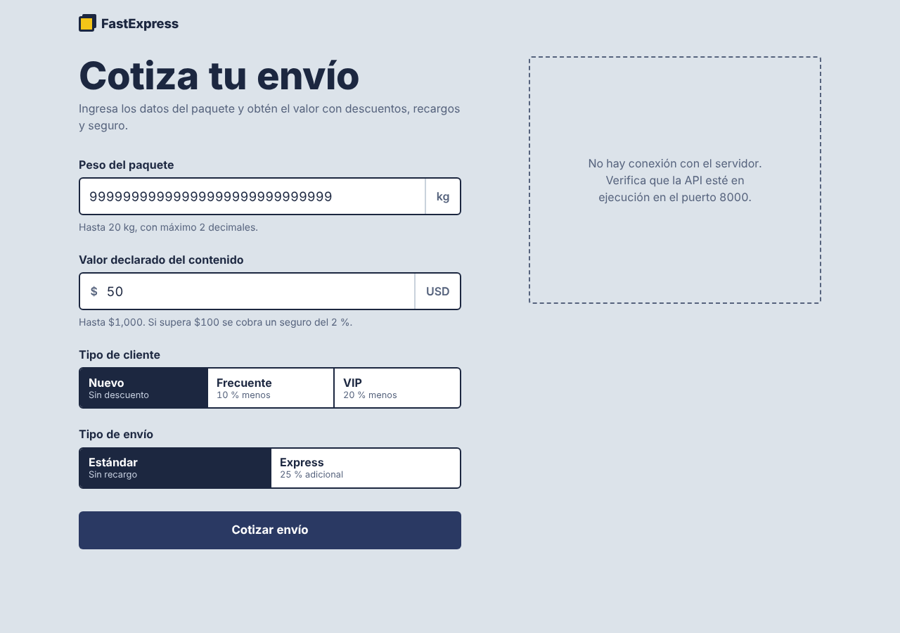

# DEF-005: un error del servidor se muestra como "No hay conexión con el servidor"

| Campo | Detalle |
|---|---|
| Estado | **Cerrado (código)** — corregido en Frontend Next.js (`hooks/useCotizacion.ts`) |
| Issue | #__ |
| Módulo | Frontend (`frontend/app.js`) |
| Severidad / prioridad propuestas | Media / Media |
| Detectado | 2026-10-13, sesión exploratoria 1, al reproducir DEF-004 desde la interfaz |
| Entorno | Linux, Chromium (Playwright), versión del 2026-10-12 |
| Frecuencia | Siempre que el servidor responde 500 |
| Prueba de reproducción | `test_DEF005_error_del_servidor_no_se_presenta_como_falta_de_conexion` (E2E, `xfail`) |

## Pasos para reproducir

1. Abrir la aplicación con el servidor encendido.
2. Escribir peso `99999999999999999999999999999` y valor declarado `50`.
3. Pulsar "Cotizar envío".

## Resultado esperado

Un mensaje que indique que el servidor tuvo un error, distinto del caso sin conexión. El servidor sí está en ejecución.

## Resultado obtenido

"No hay conexión con el servidor. Verifica que la API esté en ejecución en el puerto 8000."

**Impacto:** el usuario (o el equipo de soporte) busca un problema de red que no existe.

## Evidencia

## Notas para el desarrollador

- Es independiente de DEF-004: cualquier respuesta 500 lo produce. La prueba E2E simula el 500 interceptando la petición, así que sigue siendo válida cuando se corrija DEF-004.
- Al corregir DEF-004, los pasos de arriba ya no reproducen este defecto desde la interfaz; usar la prueba automatizada.
