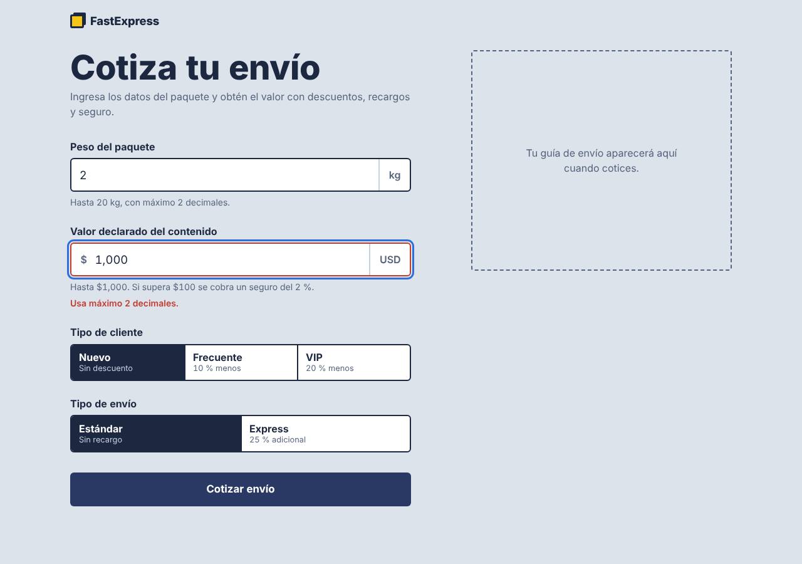

# DEF-006: escribir el monto con separador de miles da un mensaje engañoso

| Campo | Detalle |
|---|---|
| Estado | **Cerrado (código)** — corregido en Frontend Next.js (`lib/validation/validarNumero.ts`) |
| Issue | #__ |
| Módulo | Frontend (`frontend/app.js`) |
| Severidad / prioridad propuestas | Media / Media |
| Detectado | 2026-10-13, sesión exploratoria 1 (formatos de número habituales en Colombia) |
| Entorno | Linux, Chromium (Playwright), versión del 2026-10-12 |
| Frecuencia | Siempre |
| Prueba de reproducción | `test_DEF006_separador_de_miles_tiene_mensaje_claro` (E2E, 3 casos, `xfail`) |

## Pasos para reproducir

1. Escribir peso `2` y valor declarado `1,000`.
2. Pulsar "Cotizar envío".

## Resultado esperado

Un mensaje que explique que no se debe usar separador de miles (por ejemplo, "escribe 1000").

## Resultado obtenido

"Usa máximo 2 decimales."

El usuario quiso escribir mil dólares; el sistema interpretó la coma como decimal y le habla de decimales.
Pasa igual con `1.500` y `12,000` (en Colombia el punto se usa como separador de miles).

**Agravante:** el texto de ayuda del mismo campo dice "Hasta $1,000", es decir, la propia interfaz usa el formato que luego rechaza.

## Evidencia

## Notas para el desarrollador

En el campo de peso, `2,555` sí debe seguir mostrando "Usa máximo 2 decimales" (caso UI-03): un peso no llega a miles.
